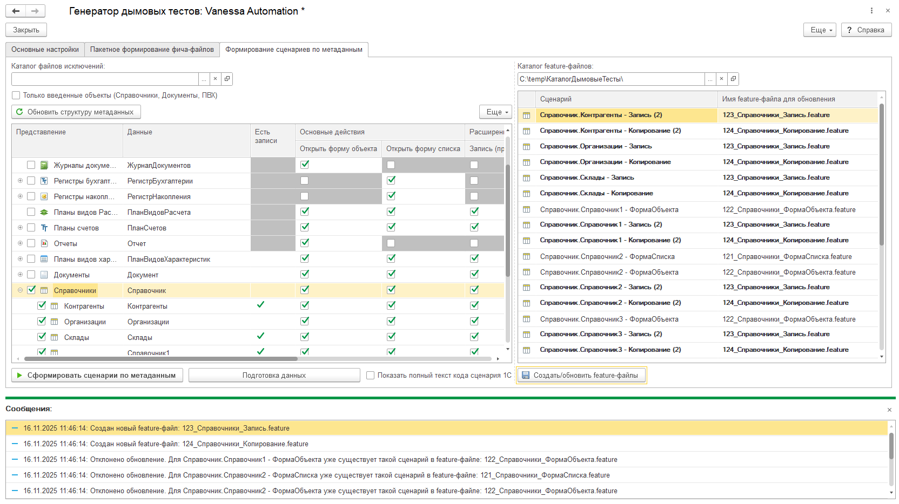

# Генератор дымовых тестов


## Основные настройки

**Каталог файлов исключений** - каталог, в котором хранятся текстовые файлы (*.txt) со списком объектов, которые будут исключены из тестирования. Имена и количество файлов произвольные однако имя файла должно начинаться  с типа объекта метаданных.
```
Справочники.txt 
Документы.txt
ПланыВидовХарактеристик.txt
ПланыСчетов.txt
ПланыВидовРасчета.txt
ЖурналыДокументов.txt
Отчеты.txt
Обработки.txt
РегистрыСведений.txt
РегистрыНакопления.txt
РегистрыБухгалтерии.txt
РегистрыРасчета.txt
```

Каждая строчка в файле - один исключаемый объект. 
пустые строки и строки которые начинаются с // (двух слешей) пропускаются

Формат строки:

**[ИмяОбъектаМетаданных].[ТипТеста].[Уточнение]**

**[ИмяОбъектаМетаданных]** - имя объекта конфигурации, как оно задано в конфигураторе
**[ТипТеста]**- тип теста, который требуется исключить, возможны варианты:
   - **ФормаСписка** - исключить открытие формы списка
   - **ФормаОбъекта** - исключить открытие формы объекта
   - **Запись** - исключить запись существующего элемента
   - **Копирование** - исключить копирование существующего элемента
   - **ВводНаОсновании** - исключить ввод на основании существующего элемента
   - **Печать** - исключить проверку печатных форм

**[Уточнение]** - уточнение по типу теста, например:
   - [ТипТеста] = Запись
	это **группа или элемент справочника**. 
	Если не указан, то и группа и элемент.
   - [ТипТеста]  = ВводНаОсновании
	это **тип документа**, который необходимо исключить из ввода на основании. 
	Если не указан, то все типы.
   - [ТипТеста]  = Печать
	это **имя печатной формы**, которую необходимо исключить из проверки. 
	Если не указан, то все печатные формы.

Примеры:


   - **ТранспортноеСообщение**
       Полностью исключить из тестов объект с именем "ТранспортноеСообщение"
   - **ВерсииРасширений.Запись**
       Исключить из тестов запись объекта с именем "ВерсииРасширений"
   - **ГруппыДоступа.Запись.Группа**
       Исключить из тестов запись группы справочника с именем "ГруппыДоступа"
   - **ТребованиеНакладная.ВводНаОсновании**
       Исключить из тестов ввод объектов на основании документа с именем "ТребованиеНакладная"
   - **АвансовыйОтчет.ВводНаОсновании.СчетФактураПолученный**
       Исключить из тестов ввод объекта с именем "СчетФактураПолученный" на основании документа с именем "АвансовыйОтчет"
   - **СчетФактураВыданный.Копирование**
       Исключить из тестов копирование объекта с именем "СчетФактураВыданный"
   - **ПередачаОС.Печать**
       Исключить из тестов печать из объекта с именем "ПередачаОС"
   - **ПередачаОС.Печать.УниверсальныйПередаточныйДокумент**
       Исключить из тестов печать печатной формы "УниверсальныйПередаточныйДокумент" из объекта с именем "ПередачаОС"

**Путь настройки файлов дымовых тестов** - указывается путь к файлу в котором указаны виды дымовых тестов которые нужно сформировать.

## Учёт прав пользователя информационной базы

Поле **«Пользователь информационной базы»** на закладке основных настроек включает фильтрацию
действий по правам выбранного пользователя. Пустое значение означает прежнее поведение: права не
проверяются, генерируются все выбранные действия.

При выбранном пользователе генератор получает состав его ролей и объединяет права ролей на каждый
объект метаданных. Проверяются только те права, которые нужны конкретному сгенерированному шагу:
открытие формы, чтение, изменение, интерактивная пометка удаления и снятие пометки, проведение и
отмена проведения, копирование, ввод на основании, чтение и просмотр, необходимые для вывода на
печать. Внутри типа «Запись» недоступные подшаги не генерируются; если у пользователя нет ни одного
изменяющего действия, сценарий «Запись» не создаётся. Недоступные флажки в дереве метаданных
снимаются; если снята только часть действий, выводится предупреждение с количеством затронутых
объектов и действий. Для видов без доступных действий снимаются флажки и в таблице пакетной
генерации. Таблица фильтруется по правам независимо от того, какие флажки пользователь оставил в
дереве: ручное изменение дерева или импорт CSV не может включить недоступный вид обратно.

Ограничения:

- список пользователей и проверка прав другого пользователя требуют административных прав. Если их
  недостаточно, генератор сообщает об ошибке и не подменяет результат «всё разрешено»; поле можно
  очистить и работать без фильтра;
- права проверяются по метаданным и ролям. RLS, функциональные опции, профили групп доступа и
  ограничения на уровне записей статически не моделируются;
- если в сеансе клиента тестирования включён привилегированный режим, `ПравоДоступа` всегда
  возвращает `Истина`; в таком сеансе фильтр недостоверен;
- сценарии, написанные вручную в таблице кода сценариев 1С, не фильтруются: это авторский код, а не
  сгенерированные по метаданным действия;
- сгенерированные сценарии рассчитаны на запуск под тем же пользователем информационной базы. В
  заголовок файла при выбранном пользователе добавляется комментарий с его именем; если TestClient
  запущен под другим пользователем, результат фильтрации может не совпадать с фактическими правами;
- пользователи и права берутся из информационной базы, в которой работает генератор (клиент
  тестирования). Менеджер Vanessa Automation и клиент тестирования должны работать в одной
  информационной базе, иначе фильтр увидит не те права;
- в режиме совместимости 8.2 методы проверки прав могут быть недоступны. Тогда при выбранном
  пользователе генератор сообщает об ошибке и не создаёт файлы; чтобы работать без фильтра, очистите
  поле. Применимые права заданы в коде по видам метаданных, а не запрашиваются у платформы.

При выбранном пользователе каталог выходных файлов очищается только после успешной генерации: если
доступных действий нет или проверка прав дала ошибки (в том числе до генерации), старые feature-файлы
не удаляются. Чтобы
сохранить это правило, тексты файлов сначала формируются в памяти; на очень больших конфигурациях
это требует дополнительной памяти. В командной строке пользователь задаётся ключом
`ДымовыеТестыПользовательИнформационнойБазы` в VAParams.

## Сохранение настроек

Настройки формы «Генератор дымовых тестов» (язык шагов, каталоги, флаги, пользователь информационной базы, начальная дата и сортировка документов) сохраняются в общих настройках Vanessa Automation кнопкой «Сохранить настройки» на командной панели. При закрытии формы с изменёнными настройками выводится вопрос; ответ «Да» сохраняет настройки в общих настройках, ответ «Нет» закрывает форму без сохранения. Сохраняются только настройки генератора — остальные общие настройки Vanessa Automation не изменяются. При первом сохранении на чистой базе общий набор настроек создаётся из текущих значений формы; при последующих сохранениях меняются только настройки генератора. Сохранённые настройки восстанавливаются после перезапуска Vanessa Automation.

Сетка флажков на закладке «Пакетное формирование фича-файлов» в общие настройки не входит: она сохраняется отдельно командой «Сохранить настройки сценариев в файл» (CSV-файл).

## Пакетное формирование фича-файлов

В форме "Генератор дымовых тестов":
   1. На закладке "Основные настройки" указать флажками нужные тесты 
   2. Перейти на закладку "Пакетное формирование фича-файлов"
   3. Отметить для выгрузки необходимые типы объектов метаданных и проставить признаки действий
   4. Нажать "Сформировать файлы"

В результате будут сформированы фича-файлы дымовых тестов в каталоге "Путь настройки файлов дымовых тестов".
   

## Формирование сценариев по метаданным

В форме "Генератор дымовых тестов":
   1. На закладке "Основные настройки" указать флажками нужные тесты 
   2. Перейти на закладку "Пакетное формирование фича-файлов"
   3. Нажать на команду "Обновить структуру метаданных", для формирование дерева метаданных в резрезе `Тип метаданного/Объект метаданного`
   4. Отметить для выгрузки необходимые объекты метаданных и проставить признаки действий
   5. Заполнить "Каталог feature-файлов" (если ранее не был заполнен в п.1)
   6. Нажать "Сформировать сценарии по метаданным"
   7. Скорректировать, если необходимо набор сформированных сценариев (открыва каждый необходимый готовый сценарий)
   8. Нажать "Создать/обновить feature-файлы", для создания новых или обновления ранее сгенерированных фича-файлов



Команда "Подготовка данных" необходима для возможности открытия формы "Подготова и загрузка данных", для быстрой генерации данных, в случае если в базе для которой подготавливаются дымовые тесты еще нет тестовых данных для расширенных действий (Запись, Копирование, Печать). Сгенерированные в результате сценарии подготовки данных, можно использовать для фича-файлов дымовых тестов.

## Копирование элементов в сгенерированных сценариях

Сценарий копирования элемента открывает форму существующего элемента и выполняет шаг

```
И я копирую элемент объекта через команду формы 'Справочник.Номенклатура'
```

Параметр шага — полное имя объекта метаданных вида `<Вид>.<ИмяОбъекта>`; по нему открывается форма
списка объекта, если команды копирования на открытой форме нет. Команду копирования шаг ищет сам
и перебирает способы:
   1. команда на открытой форме — по именам `ФормаСкопировать`/`FormCopy`, затем по заголовкам
      «Скопировать»/«Копировать»/«Copy» (кнопки копирования в буфер обмена не подходят);
   2. если команды на форме нет — открывается форма списка объекта, и копирование выполняется из неё.

Копирование считается успешным, только если после нажатия открылось новое окно — форма копии.
Если ни один способ не сработал, шаг падает и перечисляет проверенные способы и полученные ошибки.

Для групп иерархических справочников второй способ не применяется: в списке скопировалась бы
текущая строка, а не группа. Поэтому для группы нужна команда копирования на её форме, иначе шаг
падает. Второй способ копирует текущую строку списка, поэтому перед ним стоит убедиться, что
текущая строка — тот элемент, который нужно скопировать.

## Режим синхронных вызовов

Генерация дымовых тестов из командной строки выполняется в синхронном режиме: CLI-сценарий не
устанавливает флаг запрета синхронных вызовов. Если информационная база запущена с запретом
синхронных вызовов, генерация будет отклонена — как и в интерактивном режиме.

В интерактивном режиме с запретом синхронных вызовов (NoSync) генерация не поддерживается. При
нажатии «Сформировать файлы» выводится сообщение «Генерация дымовых тестов в режиме запрета
синхронных вызовов не поддерживается.», каталог выходных файлов не очищается и файлы не создаются.

## Файл настроек сценариев

Настройки сценариев сохраняются в CSV-файл. Логические флаги записываются значениями `true` и
`false` независимо от языка и локали информационной базы. При загрузке по-прежнему читаются старые
файлы с `Да`/`Нет`, `Истина`/`Ложь`, `True`/`False` и `1`/`0`; пустое или неизвестное значение
считается `false`. Если в старом файле нет одной из колонок флагов, соответствующая настройка не
изменяется.
